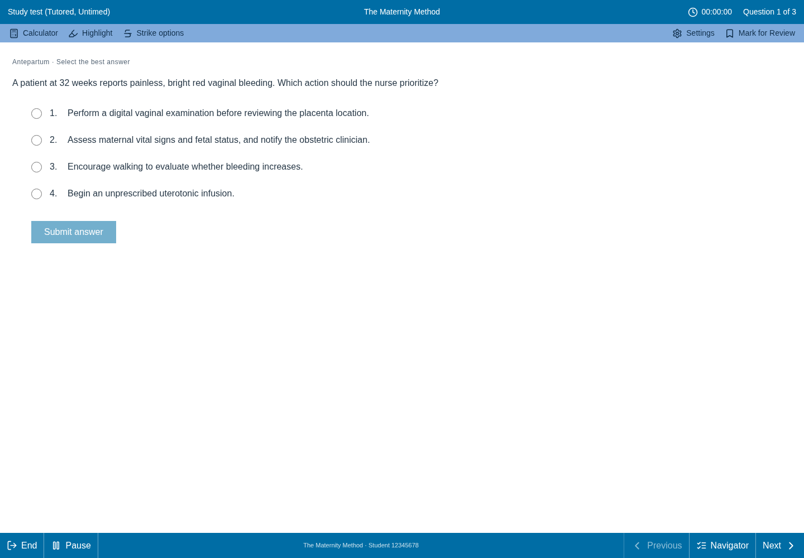
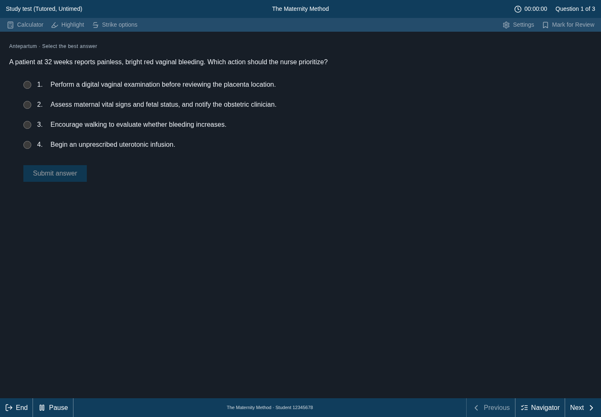

# Full-screen practice test mode

Generated study tests and timed exams now open in a full-window testing workspace,
with The Maternity Method branding and a layout inspired by the supplied reference.
The portal remains underneath and becomes inaccessible while the native modal
is open. Browser fullscreen permission is not required.

## Viewing and controls

- **Settings → Light view / Dark view** changes only the test workspace. The
  choice is remembered in this browser. Text size can be standard, large or extra
  large for the current test.
- The header shows the test mode, timer and question count. The bottom bar provides
  End, Pause/Resume, Previous, Navigator and Next/Finish controls.
- Calculator supports decimal arithmetic, parentheses, unary signs and percentages
  without evaluating JavaScript. Mark for Review and the navigator retain flags
  and show answered/incomplete status for each question.
- Highlight marks the current question. Strike options enables per-option
  elimination marks. Both are retained when moving between questions.
- Patient-chart sections use the question's actual tab titles. Single-response,
  SATA and matrix responses continue through the existing server scoring routes.
- Native modal focus management prevents keyboard interaction with the portal
  behind the test. Escape closes a tool panel, or opens the end-test confirmation.
- Copy-deterrent listeners remain active. A discreet account-linked session mark
  stays in the footer when the protection wrapper supplies it.

## Study and timed behavior

Study mode is untimed and shows elapsed active study time. Submitting an individual
answer reveals its server-provided rationale and locks that response. Timed mode
retains the existing 30-minute duration and withholds per-question feedback.

Pause hides question content and stops the active timer. The time calculation
uses a monotonic clock rather than counting interval callbacks. The practice timer
is still browser-controlled, as in the existing app; this is not a server-enforced
high-stakes testing system or an official NCLEX exam implementation.

End opens a confirmation with the answered/unanswered count. Learners can continue,
submit and save, or explicitly exit without saving. The existing exam submission
API persists the attempt and responses. Submission is locked against duplicate
clicks. Time expiry triggers one automatic submission; a failed save keeps the
answers and offers a manual retry rather than looping requests. Timed duration
is capped at 30 minutes, and study duration now records actual active study time.

Only the viewing preference persists across page reloads. In-progress questions,
answers and flags remain in browser component memory until submission; resume
across a page reload is not implemented. The existing backend limitations around
transactional attempt/response persistence remain unchanged.

## Deployment

Merge the review branch into the production branch connected to Vercel, then
verify the deployment is Ready. No Supabase SQL, schema migration, new secret or
permission change is required. Open Question Bank or Create Exam, choose Study
or Timed Test, and generate a test. This change applies to generated question-bank
tests; the separate NGN case-study library keeps its current workflow.

## Validation and previews

TypeScript and the repository tests pass. Chromium tests use the actual builder,
exam component, protection wrapper and styles with isolated API fixtures. They
cover light/dark persistence, text size, focus isolation, keyboard dialog handling,
calculator, flags/navigation, highlighting/strike marks, single/SATA/matrix answers,
study feedback, pause/resume, scoring payloads, duplicate submission prevention,
recorded duration, timeout/save-error retry, results navigation, loading errors,
exit without saving and mobile layout. Live authenticated Supabase submission
has not been tested in this environment. Vercel's build remains the deployment
check because local production builds have an existing Google Fonts network block.

The screenshots show illustrative repository sample content and a fictional
student identifier, not a live account.

### Light view

### Dark view

